# Parle French Sounds

A small teaching dataset of French pronunciation from [Parle](https://www.parleapp.fr/), the French pronunciation app. It powers the sound guide on [parleapp.fr](https://www.parleapp.fr/french-pronunciation-app/) and the sound lessons inside the app.

Also on Hugging Face: [huggingface.co/datasets/Parle-App/parle-french-sounds](https://huggingface.co/datasets/Parle-App/parle-french-sounds)

## The French vowels, mouth by mouth

| Mouth | Sound | As in | How to say it |
|---|---|---|---|
| 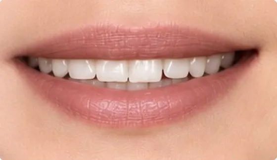 | **[i]** | merci, ici | Smile wide, tongue high and forward. Short and tense. |
| 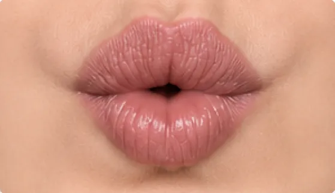 | **[y]** | tu, plus | Say "ee", then round your lips tightly without moving your tongue. |
|  | **[u]** | vous, pour | Lips tightly rounded and pushed forward, tongue pulled back. |
| 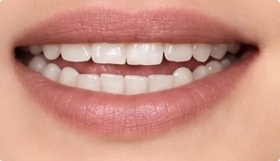 | **[e]** | parlez, été | A slight smile and one steady, short sound. No glide. |
| 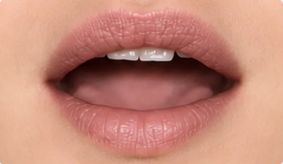 | **[ø]** | peu, deux | Tongue placed as for [e], lips rounded as for [o]. |
| 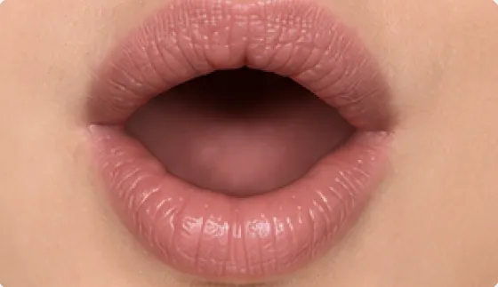 | **[o]** | hôtel, beau | Round your lips and hold one pure vowel. |
| 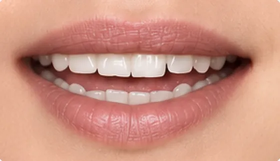 | **[ɛ]** | avec, père | Like "bed", with the jaw a little lower than for [e]. |
| 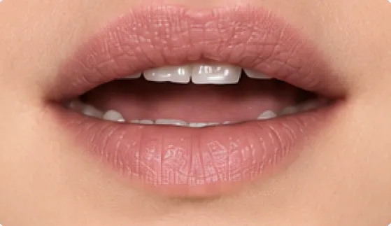 | **[œ]** | fleur, heure | Mouth more open than for [ø], lips loosely rounded. |
| 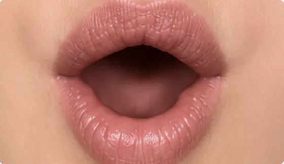 | **[ɔ]** | alors, homme | Drop the jaw and keep the lips rounded. |
| 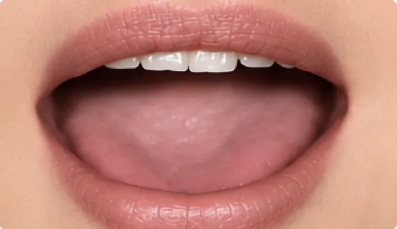 | **[a]** | avec, la | A bright, front, open "a". Keep it short. |
| 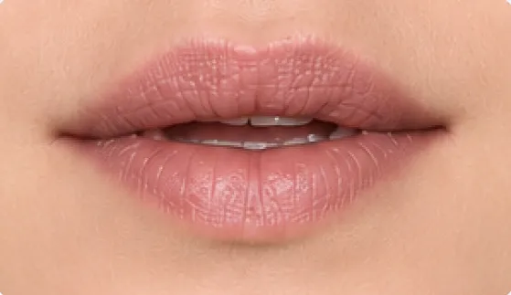 | **[ə]** | le, petit | A relaxed, slightly rounded "euh". Often dropped in fast speech. |
| 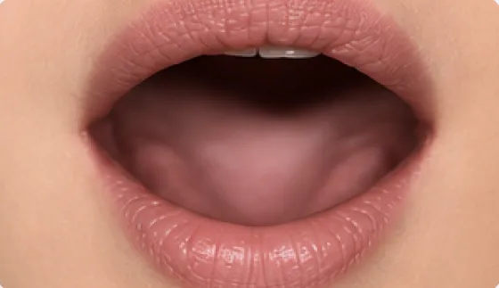 | **[ɑ̃]** | sans, en | Open back vowel with air through the nose. No N at the end. |

## Contents

**`french_vowels.jsonl` / `.csv`** has 12 rows, one per French oral or nasal vowel:

| Field | Description |
|---|---|
| `id` | short slug, e.g. `y`, `an` |
| `ipa` | IPA symbol, e.g. `y`, `ɑ̃` |
| `example_words` | everyday French words with the sound |
| `mouth_image` | illustration of the mouth position (559×323 WebP, in `images/`) |
| `common_mistake_{en,fr,es,ja}` | the typical learner mistake, in 4 languages |
| `how_to_say_it_{en,fr,es,ja}` | a one-line fix, in 4 languages |

**`hardest_sounds.jsonl`** has 12 rows: the 3 sounds English speakers miss most (the French R, the U of *tu*, the nasal vowels), each in English, French, Spanish and Japanese. Fields: `language`, `id`, `ipa`, `title`, `summary`, `common_mistake`, `steps` (step-by-step instructions), `practice_words`.

```python
from datasets import load_dataset

vowels = load_dataset("Parle-App/parle-french-sounds", "french_vowels", split="train")
print(vowels[1]["ipa"], vowels[1]["how_to_say_it_en"])
```

## Source and license

Written and illustrated by the Parle team. The texts were written for learners, not as a phonetics reference; the French, Spanish and Japanese versions are the same content as on parleapp.fr. Released under [CC BY-NC 4.0](https://creativecommons.org/licenses/by-nc/4.0/) (non-commercial): free for learning, teaching and research with credit to "Parle — parleapp.fr" and a link to https://www.parleapp.fr/. Commercial use, including in other language-learning apps or AI training for commercial products, is not permitted without written permission from Parle (support@parleapp.fr).

Related: [Parle French Sound Words](https://huggingface.co/datasets/Parle-App/french-sound-words) (37 sounds, 1,088 example words with IPA) and the [Parle French phoneme recognizer](https://huggingface.co/Parle-App/parle-french-phoneme-recognizer), an on-device model that recognises these sounds in recordings.

Practise these sounds with your own voice in the [Parle app](https://www.parleapp.fr/) for [iPhone](https://apps.apple.com/app/id6447072574) and [Android](https://play.google.com/store/apps/details?id=io.parle.parleapp).
